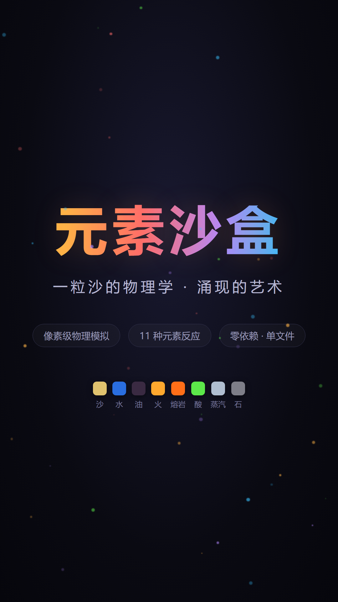
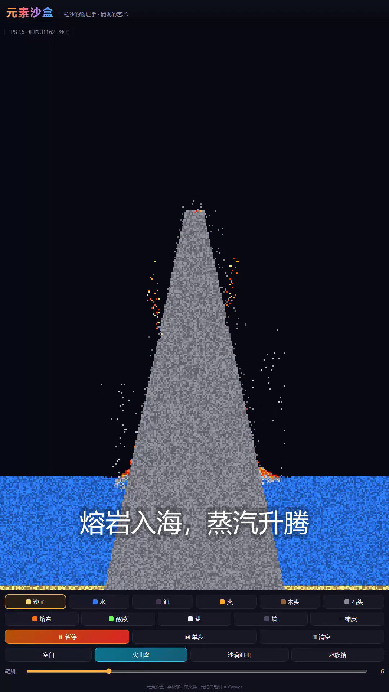
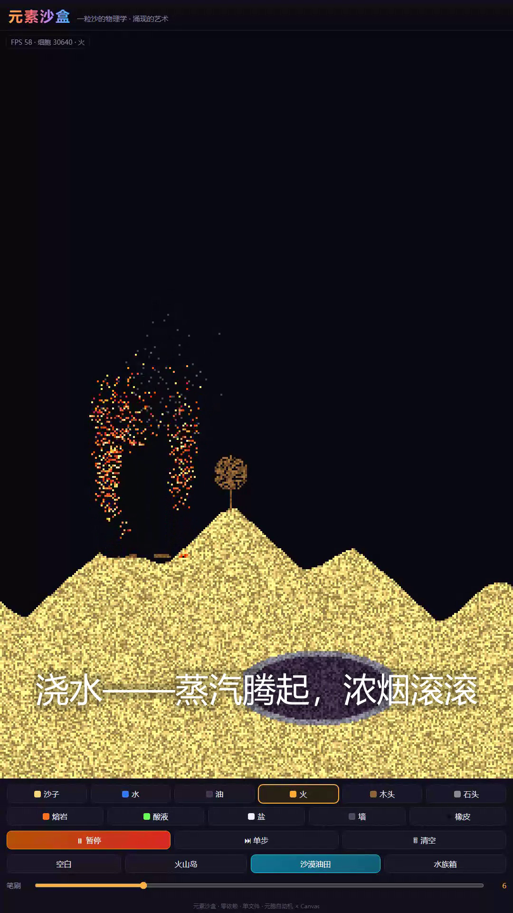
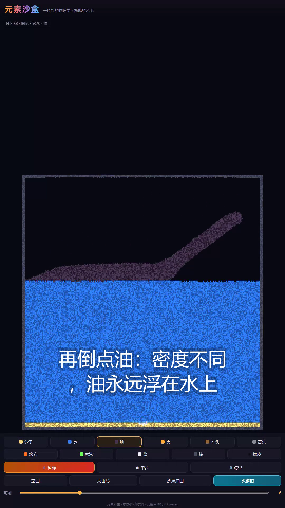

# 元素沙盒 · Element Sandbox

> 一粒沙的物理学，涌现的艺术。
> 像素级落沙物理模拟 —— **零依赖、单文件、双击即玩**。



## 项目背景

「落沙模拟」（Falling Sand）是元胞自动机里最迷人的一类玩具：每个像素只是一粒遵守几条局部规则的细胞，组合起来却能长出沙丘、洋流、火灾与火山。本项目用**一个 HTML 文件**实现了完整的元素沙盒，并配了一条 9:16 竖屏演示视频（见下方成果展示），证明简单规则足以涌现复杂世界。

## 功能特性

- **11 种可绘制元素**：沙、水、油、火、木头、石头、熔岩、酸液、盐、墙、橡皮
- **真实的元素反应**（全部实时计算，无任何预制动画）：
  - 火蔓延烧掉木头与油，产生浓烟；浇水灭火，蒸汽升腾
  - 熔岩遇水冷却成石头 + 蒸汽，缓慢凝结为新陆地
  - 盐溶于水变成盐水；盐水受热，水分蒸发、盐重新析出
  - 酸液腐蚀沙、木、石，腐蚀时冒起青烟
  - 油密度小于水，永远浮在水面上
- **笔刷系统**：可调半径（1–22），快速划动自动插值不断线
- **3 个预设场景**：火山岛 / 沙漠油田 / 水族箱，一键进入"事故现场"
- **控制**：暂停、单步（逐帧解剖物理过程）、清空
- **HUD**：实时 FPS 与细胞计数；键盘快捷键（空格 = 暂停，数字键 1–9/0 切换元素）
- 移动端可用：触屏绘制，竖屏自适应布局

## 运行方法

无需安装任何东西：

```bash
# 方式一：直接双击 index.html
# 方式二：起个静态服务器（可选）
python -m http.server 8000
# 打开 http://localhost:8000/index.html
```

## 成果展示

**演示视频**（1080×1920 · 98s · 含字幕与配乐）：

https://github.com/qw101233/element-sandbox/raw/main/video/element-sandbox-demo.mp4

| 火山岛 | 沙漠油田火灾 | 水族箱 |
| --- | --- | --- |
|  |  |  |

## 项目结构

```
element-sandbox/
├─ index.html                 # 游戏本体（单文件，全部逻辑与 UI）
├─ README.md / PROJECT.md
├─ tools/
│  ├─ verify.js               # 自动化验证：9 项物理断言 + FPS + 截图（Playwright）
│  ├─ record.js               # 演示视频录制：5 个场景脚本化操作
│  ├─ title.html              # 视频片头卡
│  ├─ make_bgm.py             # 环境音乐合成（numpy）
│  └─ build_video.py          # 视频组装：转码→拼接→烧字幕→混音（ffmpeg）
├─ screenshots/               # 验证截图与演示图
└─ video/
   └─ element-sandbox-demo.mp4   # 最终竖屏演示视频
```

## 技术说明

- **模拟核心**：`Uint8Array` 网格 + 逐细胞行为函数；粉末/液体/气体分别走下落、密度交换、扩散与上升规则；反应（燃烧、腐蚀、溶解、凝结）由邻居检测驱动
- **渲染**：预计算 `Uint32` 调色板 + `ImageData` 快通道，每细胞 4 档明暗在创建时固定，避免颜色闪烁；火焰与熔岩按寿命/时间流动态取色
- **性能**：1080×1920 视口下约 10 万细胞，稳定 60 FPS
- **验证**：`tools/verify.js` 注入粒子并断言沉降、流动、燃烧、成石、酸蚀等行为，9/9 通过

## 开发与复现视频

```bash
cd tools
node verify.js        # 运行验证（需 playwright）
node record.js        # 录制 5 段原始素材到 video/raw/
python make_bgm.py    # 合成背景音乐 bgm.wav
python build_video.py # 输出 video/element-sandbox-demo.mp4
```

---

*Made by 狗蛋 🐶 with WorkBuddy — 简单规则，复杂世界。*
